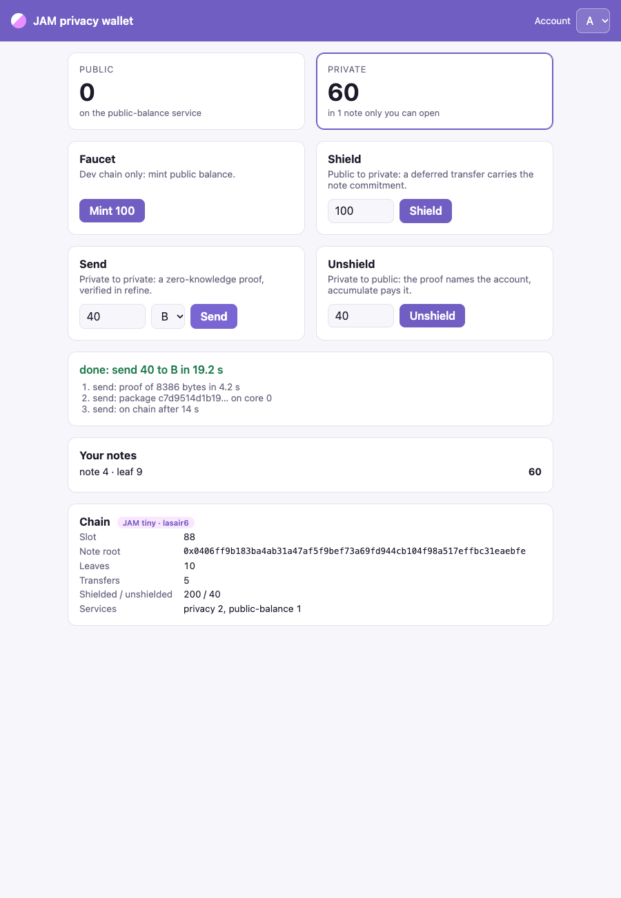

# jam-privacy-service

Shielded payments as a JAM service. A user proves a private transfer on their own machine
with a Noir circuit and Barretenberg; `refine` verifies the UltraHonk proof on the PVM;
`accumulate` checks the old note root, refuses spent nullifiers, and writes the new roots,
nullifiers and leaves. Value enters and leaves by JAM deferred transfers: shield and
unshield. It runs on a local six-validator JAM tiny testnet, with a wallet in the browser.

It is Aztec's model (`zk.money`'s shield, send, unshield) on JAM's own L1, built from
Aztec's tools: Noir, Barretenberg, and a fork of Aztec's demo-wallet. Why: [JAM beside
Aztec](https://abutlabs.github.io/the-gray-tutor/jam-beside-aztec). How it got here:
[docs/PLAN.md](docs/PLAN.md) and [docs/LEDGER.md](docs/LEDGER.md); the work is tracked as
[issues](https://github.com/abutlabs/jam-privacy-service/issues).



## Demo

You need Docker (running), Rust, Python 3, Node, Noir `1.0.0-rc.5` and bb `5.0.0`
(install lines in [docs/TOOLS.md](docs/TOOLS.md)), and these sibling checkouts:
`../jamswap` (the testnet compose files and JIP-2 tooling), `../lasair` and
`../demo-wallet` on its `jam` branch. One word a stage:

```sh
nets/demo.sh up         # six lasair validators, both services deployed, the indexer and the wallet
nets/demo.sh check      # no browser: shield, send, unshield, every value read back from the chain
nets/demo.sh shield     # A shields 100 (the faucet mints first if A is short)
nets/demo.sh send       # A sends 40 to B privately
nets/demo.sh unshield   # B unshields 40 to B's public account
nets/demo.sh down       # stop everything, wipe the chain
```

The wallet is at <http://localhost:19710/?user=A>; open `?user=B` in a second browser to
watch the payment arrive. `send` and `unshield` take arguments (`nets/demo.sh send A B 25`).
`node client/e2e/e2e.mjs` (after `npm install` in `client/e2e`) drives two browsers
through the same three moves and saves the screenshots in [docs/images](docs/images).

What `check` asserts, and prints line by line: the note root changed three times, each
time to the root the prover computed, and the root rebuilt from the chain's own leaves
equals it; the six nullifiers are recorded and the nullifier root chains through the
three proofs, so nothing else was spent; A is at −100 from the shield, B at +40 from the
unshield, both by deferred transfer; a replay of the send changes nothing.

## Numbers

| What | Value | Where |
| --- | --- | --- |
| One UltraHonk verification in `refine` (the transfer circuit, zk, 12 public inputs, bb 5.0.0) | **167,281,732 gas**, under a second on lasair | in-process rig; [#13](https://github.com/abutlabs/jam-privacy-service/issues/13) |
| The verifier on a one-input circuit | bb 5.0.0: 286,136,021 gas zk, 272,022,666 plain; bb 3.0.3: 312,260,095 and 302,381,955 | `spikes/ultrahonk-gas/measure.sh`, #13 |
| A rejected proof (tampered byte, altered public input) | 0.5 to 9.7 million gas | `services/privacy/check.sh`, the spike |
| Accumulate for one complete send (roots, two nullifiers, two leaves, counters) | 103,167 gas, 1% of a report's 10 million | in-process rig |
| Proving a transfer on a laptop | about 0.5 s (bb 5.0.0; 2.5 s on bb 3.0.3) | `client/privacy.py` |
| A send, submit to on chain | about 15 to 20 s, two to three slots | wallet |
| `nets/demo.sh up` from clean, images cached | 1 min 24 s to 1 min 40 s | ledger |
| `nets/demo.sh check` on a fresh chain | 2 min 34 s to 3 min 13 s, 34 assertions | ledger |

A tiny package's refine budget is 1 billion gas, so five verifications fit in one; a full
package's 5 billion holds 29. The time is the chain's, not the proof's: a move waits two to
three slots, longer when lasair loses a package and the demo resends it.

## What is real and what is reduced

Real:

- **The proofs.** Barretenberg 5.0.0 UltraHonk (Keccak transcript, zero-knowledge) of a Noir
  join-split, made on the sending side, verified in `refine` on the PVM by a pure-Rust
  verifier compiled into the service. A tampered proof or an altered public input is
  rejected.
- **The state.** Note root, nullifier root, nullifiers and leaves in service storage,
  written by `accumulate` only after the old root matches and no nullifier is spent. A
  replayed proof is dropped.
- **Shield and unshield.** JAM deferred transfers between two services: the shield's memo
  carries the note commitment, the unshield's carries the receiving account.
- **The network.** Six lasair validators (an independent GP 0.8.0 client) on one tiny-spec
  genesis, with GRANDPA finality; services deployed through the Bootstrap service over
  JIP-2; packages guaranteed by three co-signing validators.

Reduced, each with an issue that names the price and the way back:

- **The circuit is ours, not Aztec's kernels** ([#18](https://github.com/abutlabs/jam-privacy-service/issues/18)).
  Aztec's note and nullifier shapes with Poseidon2, a depth-16 tree (Aztec: 40), nullifier
  non-membership checked by the chain rather than an indexed tree in the proof, no
  encrypted notes on chain.
- **The wallet is one local process holding every user's key** ([#19](https://github.com/abutlabs/jam-privacy-service/issues/19)).
  The page lives in the demo-wallet fork but is not its React app or the Aztec PXE;
  proving runs on the host, not in the browser; a receiver learns of a note because the
  same process made it.
- **No folding.** One proof per package. The "builder" is the indexer's submit path,
  which wraps a payload in a work-package; Aztec's tx-base and merge circuits are not used.
- **Dev-chain money.** The public-balance service has a faucet anyone may call.
- **lasair's lost packages** ([lasair#93](https://github.com/abutlabs/lasair/issues/93)).
  A package can go Ready on JIP-2 and still expire before it is reported; the demo resends
  after 36 s, safe because both services apply a payload once (nonces, nullifiers).
- **The testnet plumbing lives in jamswap** ([#17](https://github.com/abutlabs/jam-privacy-service/issues/17)).
  The plan is to move it into a fork of jamixir's jamboree and offer it upstream.

## Layout

| Path | What |
| --- | --- |
| `services/privacy/` | the privacy service: verify in refine, roots and nullifiers in accumulate |
| `services/public-balance/` | the public side: balances, faucet, shield out, unshield in |
| `crates/service-util/` | what both services share |
| `circuits/transfer/` | the Noir join-split; `circuits/hash_cli/` is the client's Poseidon2 |
| `client/privacy.py` | notes, the tree, witnesses, proofs, payloads |
| `client/wallet.py` | the wallet's backend: the page plus `/api/{state,mint,shield,send,unshield}` |
| `client/e2e/` | two browsers, three moves, six screenshots |
| `indexer/indexer.py` | follows the chain over JIP-2, serves it over HTTP |
| `nets/` | `demo.sh` (the stages), `lasair6.sh`, `jamctl.py` |
| `spikes/ultrahonk-gas/` | the gate: the verifier's gas on the PVM |

The services build with jamswap's `jam080-build` (GP 0.8.0); the crates.io `jam-pvm-build`
targets GP 0.7.2. Apache-2.0.
