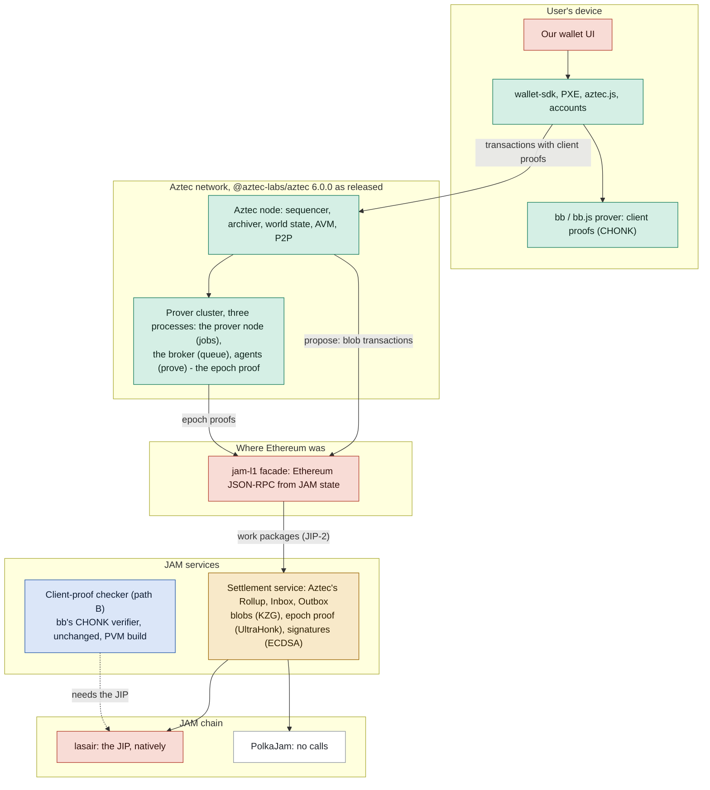

# Aztec on JAM: what is Aztec's, what is ours, what needs the JIP

Aztec's software runs as released, above the settlement layer; JAM takes Ethereum's place below
it. This file sorts each part by whose code it is, says how it keeps up with Aztec's releases,
and says which parts need the proposed curve host calls (`docs/jip`). The plan that follows from
it is #71. As a page: https://abutlabs.github.io/aztec-on-jam/aztec/

Green: Aztec's code, unchanged (a release is a re-pin). Blue: Aztec's source, unchanged, our
build for the PVM. Amber: ours, ported from Aztec's spec each release. Red: ours, new, in
Ethereum's place. 

## Who checks the client proofs: two paths

- **A. Aztec's own design.** The sequencer checks each client proof on arrival, and the rollup
  circuits fold them into one epoch proof. JAM checks the epoch proof, the blobs and the
  signatures. No curve call is required; the calls make an epoch's settlement 5.6× cheaper and a
  checkpoint's blob check 2.9×.
- **B. JAM checks each client proof — refine checking the work is JAM's point.** Refine runs Aztec's own verifier on every transaction's
  proof (`spikes/chonk-pvm`, #62). Call 105 is required: without it one proof is 11.36B gas, more
  than two full packages; with it, 3.46B. Accumulate would also keep Aztec's trees (#21).

## What the JIP changes

Refine gas, the protocol's, measured on lasair. A tiny package holds 1e9, a full one 5e9.

| Check in refine | Without | With | Calls | Needed? |
|---|---|---|---|---|
| Settling an epoch: root rollup proof and batched blob opening | 340.8M | 60.6M | 101–104 | No |
| Aztec's 2^24 epoch proof alone (UltraHonk) | 155.9M | 52.4M | 101, 102 | No |
| A checkpoint's 6 blobs against their KZG commitments, batched | 937.1M | 328.0M | 103, 104 | No; without them it nearly fills a tiny package |
| Proposer and attestation signatures (ECDSA, secp256k1) | 433M | 433M | none proposed | No |
| One Aztec client proof (CHONK), path B | 11.36B | 3.46B | 105 | **Yes**, and the full refine budget |
| A private transfer: our UltraHonk proof at Aztec's size (the proposal's benchmark) | 147.0M | 49.1M | 101, 102 | No |

Sources: `spikes/jip8-lasair` (LEDGER 74), `spikes/chonk-pvm/RESULTS.md`, `spikes/ecdsa-gas`.

## Keeping up with Aztec's releases

| Part | Whose code | Per Aztec release |
|---|---|---|
| Wallet, PXE, aztec.js, contracts, circuits, node, prover node | Aztec's, unchanged | Re-pin. Re-run `tools/aztec-local`'s L1 record for new RPC expectations |
| CHONK verifier in refine | Aztec's C++, our PVM build | Export bb's sources at the tag and rebuild (`spikes/chonk-pvm/build.sh`); the two wrapped MSM symbols may move |
| Epoch-proof verifier in refine | Ours, ported | From bb's Solidity verifier diff; v5→v6 was two changes (`RELEASES.md`) |
| Settlement service | Ours, ported | Follow ProposeLib, EpochProofLib, Inbox, Outbox; v6 rewrote the Inbox. A stale service is caught by the epoch proof |
| jam-l1 facade | Ours, new | Follow the node's L1 calls; v5→v6 moved 80 lines in `rollup.ts` and 379 in the publisher, same methods |
| Node configuration | Aztec's code, our values | Chain id, contract addresses, genesis values |

## Licences

| Code | Licence |
|---|---|
| aztec-node (node, PXE, aztec.js sources), aztec-packages, Aztec.nr | Apache-2.0 |
| bb.js | MIT |
| Noir packages | MIT or Apache-2.0 |
| `@aztec-labs/*` npm packages | no licence field; their source repository is Apache-2.0 |
| AztecProtocol/demo-wallet | **none**: no licence file or field, so all rights are reserved by default |

## The wallet

**Ours, on Aztec's libraries — built (`wallet/`, #65).** Our interface over Aztec's Apache-2.0
libraries: `@aztec-labs/wallets`' browser build (the PXE in the tab, SQLite on OPFS), Aztec's
prover and Token contract, Aztec's note tagging, fees through the SponsoredFPC. Aztec's
demo-wallet (which has no licence) was the reference only; none of its code is copied. An Aztec
release is a re-pin. Measured in the e2e (two browser contexts, real client proofs in the tab):
token deploy 23 s, private mint 10 s, private send 23 s; the receiver finds the note by tagging.

## What we checked (2026-10-27, one Apple M-series Mac)

**A full PXE runs in a browser tab.** The demo-wallet's `web` app builds the PXE with
`createPXE` from `@aztec-labs/pxe/client/lazy`, stores in SQLite on OPFS and proves with bb.js
(`web/src/wallet/wallet-service.ts`). It needs cross-origin isolation (COOP same-origin, COEP
require-corp) for threads. Its build: 61.4 MB of assets, 31.1 MB gzipped, of which 28.9 MB raw
(16.3 MB gzipped) is 52 private-kernel circuits loaded on demand, and an 18.3 MB bb WASM
(4.1 MB gzipped). The tab downloads the proving parameters (CRS, about 20 MB) from Aztec's CDN
the first time it proves.

**Real client proofs in Chrome** (bb.js 6.0.0, published as `@aztec-foundation/bb.js`; Aztec CI's
pinned inputs; every proof also verified by native bb, and a flipped bit refused):

| Flow | Threads | Chrome, median of 3 | Native bb | Peak memory, Chrome |
|---|---|---|---|---|
| Token transfer, sponsored fee (6 circuits) | 10 | 3.6 to 3.9 s | 2.2 s | 1.3 to 1.4 GB in all, 0.7 to 0.85 GB the prover's process |
| The same | 1 | 14.3 s | 9.5 s | |
| Storage proof, 7 layers (10 circuits, the slowest flow) | 10 | 15.4 s | 8.5 s | 1.85 GB in all |

Proofs are 80,096 and 128,192 bytes, as natively. Starting bb takes 4.4 s the first time (the
CRS download) and under 0.8 s after.

**Fees go to our own sequencer.** Fees are paid in Aztec's fee token to the sequencer that
builds the block, on our devnet our own node. Nothing in the wallet pays anyone else; it has no
fee recipient of its own. A new account cannot hold fee juice at genesis (its address is
random), so it pays through Aztec's sponsored-fee contract (SponsoredFPC, salt 0, address
`0x2d8fff82…69d3`), which genesis funds. With the account type that needs no deployment
("Schnorr, initializerless"), nothing else is needed.

**The node verifies real client proofs (#67, done).** Real-proof mode is the devnet's default:
Aztec's node checks each transaction's CHONK proof with native bb before pooling it; a proof
with one field changed is refused in 141 ms, and the wallet's in-tab proofs pass unchanged.

**The devnet runs on lasair (#66, done).** `DEVNET_NET=jb-lasair6` puts the settlement service
on six lasair validators with the curve calls on; the wallet's whole story passes on it, and a
checkpoint's refine costs 64.06M gas with the calls against 251.46M without (3.9×; the same blob
falls back to PVM code). One timebase ties it together: cfg's `jamEra` (unix time of JAM slot 0)
drives both the service's clock and the facade's L1-block timestamps, and every net runs its slots
on the wall clock (lasair's `--era` for an all-lasair net), so Aztec's wall-clock slots and JAM's
agree however busy the machine is.

**Aztec's prover proves every epoch, and JAM verifies each proof (#69, done).** `on-jam.sh` runs
Aztec's prover as Aztec's operator docs lay it out: a broker, a prover node and an agent, each
its own process, plus a second agent in Aztec's own Docker image for public execution (the AVM
prover is published for Linux only). On a 10-core, 16 GB laptop the root rollup proves in 60 to
171 s, and a transaction with public calls takes 140 to 330 s in the rollup (6.4 GB peak, so
one public-execution agent at a time). The sidecar relays each epoch proof as work item kind 2;
refine verifies it (70.7M gas) against public inputs recomputed from the service's own state, and
accumulate advances the proven tip.

**The wallet shows who does what (#74, done).** Shield, unshield, send and receive, with five
live lanes (this tab, Aztec's node, the sidecar, JAM's validators, Aztec's prover) and each
action's timeline to "proven". It reads the sidecar's `jam_activity`; cryptography stays in
Aztec's libraries.

**The devnet funds the sponsor at genesis (#64, done).** `aztec start --node` funds the
SponsoredFPC only with `SPONSORED_FPC=true`; `on-jam.sh` now sets it, configures the settlement
service with the matching genesis archive root
(`0x0ad1dcc0e08d2b1c82a79af5685598e631e881187c3c9734ad28df5dbcf5db48`, computed with the node's
own `getGenesisValues`), and serves the node on `localhost:8080` (NODE_PORT overrides), where a
wallet built for Aztec's local network looks.

**The committee is open today.** The facade reports an empty committee, which Aztec's node
treats as open: anyone proposes and nobody attests (`epoch-cache/src/committee_lookup.ts`), as
Aztec's own local network runs. A committee needs the facade to report `cfg`'s committee and
several Aztec nodes with P2P and validator keys; the settlement service already checks the
signatures (#54).

## The plan

Each step is an issue under #71; the order is the plan's.

1. **#64 The devnet ready for a wallet** (done).
2. **#65 Our wallet on Aztec's libraries** (done).
3. **#66 The devnet on lasair,** with the curve calls on (done).
4. **#67 The node checks real client proofs** (done).
5. **#69 Real epoch proofs** (done).
6. **#74 The wallet's live view** (done).
7. **#70 The demo on Aztec's stack:** re-recorded on this stack, the first demo retired (done).
8. **#68 A committee and P2P.**
9. **#73 Refine checks every client proof:** batch verification in one package, the reference
   string as a preimage, Aztec's trees in accumulate. Required, not optional.

Separately, #62 checked Aztec's client proofs in refine with Aztec's own verifier (path B, done);
#73 makes that the rule for every transaction.
